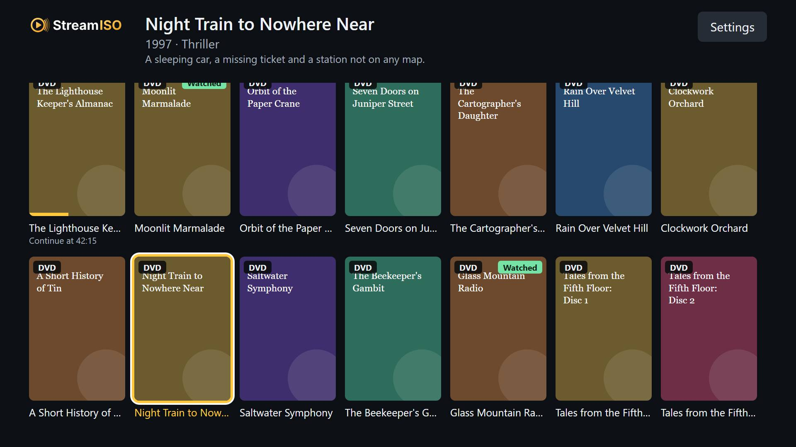
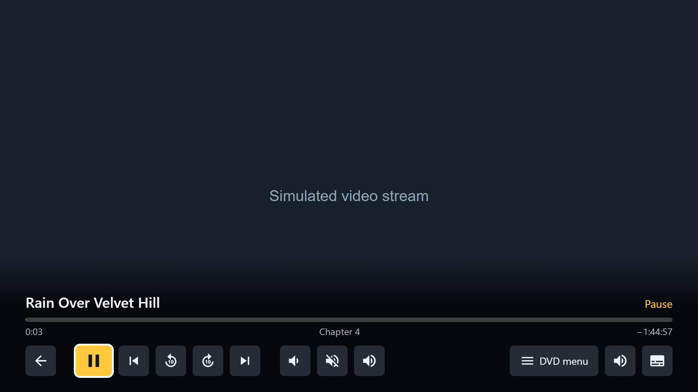

<p align="center">
  
</p>

# StreamISO for LG TV

An LG TV (webOS) app for [StreamISO](https://github.com/rubinhos/streamiso), the self-hosted library that plays your
DVD images and audio CD images with their real menus. It has its own screens and controls, made for the remote. You need a
running StreamISO server. To learn more about StreamISO itself, see [its repository](https://github.com/rubinhos/streamiso).

It is a port of [StreamISO for Samsung TV](https://github.com/rubinhos/streamiso-tizen), with the same screens and keys.

> **Vibe coded:** written with an AI assistant ([Claude](https://claude.ai)) and tested by the author.
> **Early prototype:** tried on one TV, a 24TL520S (webOS 3.x), where the catalog works but video does not yet.

| | |
|---|---|
|  |  |

## Which TVs

LG TVs with webOS that can run LG's **Developer Mode** app. The code is plain ES5, and the video route is chosen by
what the TV's engine can do, not by the model:

| webOS | Model years | Engine | Video route | Status |
|---|---|---|---|---|
| 3.x | 2016–2017, and LG's monitor TVs such as the 24TL520S | Chrome 38 | None yet | Catalog tested. No video: the engine's WebRTC has only DTLS 1.0, and Neko needs DTLS 1.2 (tested: "unsupported protocol version") |
| 4.x | 2018–2019 | Chromium 53 | Built-in client | Not tested |
| 5.x | 2020 | Chromium 68 | Built-in client | Not tested |
| 6.x | 2021 | Chromium 79 | Built-in client | Not tested |
| 22 and later | 2022 on | Chromium 87+ | Neko page in an iframe | Not tested |

**Settings → General → About this TV** shows the webOS version. Some TVs from other brands also run webOS ("webOS Hub");
they may not offer the Developer Mode app.

## Installing

The `.ipk` package is built by GitHub Actions. Download it from
[Releases](https://github.com/rubinhos/streamiso-webos/releases), or from the artifacts of the latest
[Build](https://github.com/rubinhos/streamiso-webos/actions/workflows/build.yml) run.

To put it on the TV you need a PC on the same network as the TV, with one of these:

- **Docker**, with this repository cloned: `tools\ares.cmd` (Windows) or `tools/ares.sh` runs LG's
  [webOS CLI](https://webostv.developer.lge.com/develop/tools/cli-installation) in a container, built the first time.
  The TV's settings and key stay in `.ares/`, which git ignores.
- [webOS Dev Manager](https://github.com/webosbrew/dev-manager-desktop), a desktop app that needs nothing else, or
- the webOS CLI installed with Node (`npm install -g @webos-tools/cli`).

### 1. Set up the server

Add this to StreamISO's `.env`, then run `docker compose up -d`:

```ini
CORS_ORIGIN=null
```

### 2. Turn on developer mode on the TV

1. Create a free account at [LG's developer site](https://webostv.developer.lge.com).
2. On the TV, install **Developer Mode** from the LG Content Store, and sign in with that account.
3. Turn on **Dev Mode Status**, let the TV restart, open **Developer Mode** again and turn on **Key Server**.
4. Note the TV's IP address and the passphrase shown in the app.

Developer mode lasts 50 hours at a time. Open the Developer Mode app and choose **Extend** before it runs out, or
run `ares-extend-dev --device tv` (with Docker, `tools\ares.cmd ares-extend-dev --device tv`). When it runs out, the
apps you installed are removed.

### 3. Install

**webOS Dev Manager:** add the TV with its IP address and passphrase, then install the `.ipk` from the **Apps** tab.

**Docker,** in PowerShell or Command Prompt, from the folder that has the `.ipk` (use `tools/ares.sh` the same way in a
Unix shell):

```powershell
# Once: add the TV (its IP address) and get its key (enter the passphrase shown on the TV)
C:\dev\streamiso-webos\tools\ares.cmd ares-setup-device -a tv -i "host=192.168.0.20" -i "port=9922" -i "username=prisoner"
C:\dev\streamiso-webos\tools\ares.cmd ares-novacom --device tv --getkey

# Each version
C:\dev\streamiso-webos\tools\ares.cmd ares-install --device tv io.github.rubinhos.streamiso_0.1.0_all.ipk
```

Give file paths relative to the current folder, with forward slashes: only that folder is visible in the container.

**webOS CLI installed with Node:** the same commands, without `tools\ares.cmd`.

### 4. Open the app

Open **StreamISO** in the TV's app list, enter your server's address (for example `192.168.0.10:8080`) and choose
**Save and connect**. The app remembers it, and you can change it later in **Settings**.

## Releases

Push a tag such as `v0.2.0`. GitHub Actions runs the tests, puts that version in the app, builds the `.ipk` and publishes
it as a release.

## Development

See [docs/DEVELOPMENT.md](docs/DEVELOPMENT.md) for the remote's keys, running the app on a PC, the tests and what still
needs checking on a TV.

## License

[Apache License 2.0](LICENSE). See [NOTICE](NOTICE). "StreamISO" is not affiliated with Stremio or with LG Electronics.
